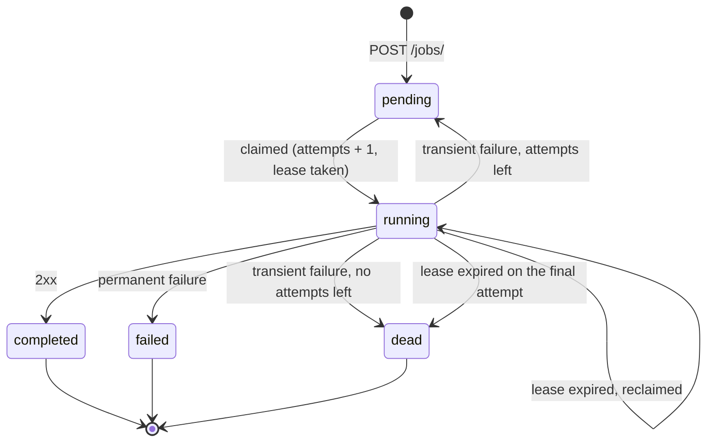

# Design

How the Retry Scheduler handles the job lifecycle, retry decisions, duplicate processing, multiple workers and testing. Setup, assumptions and trade-offs live in the [README](../README.md).

## Job lifecycle



A job is one row in `jobs`. Besides `status` it carries `attempts` / `max_attempts`, `next_retry_at` (when it becomes due), `locked_until` (the lease of the worker currently delivering it) and `last_error`.

- `pending` — waiting for its first attempt or for a retry at `next_retry_at`.
- `running` — claimed by a worker that holds the lease.
- `completed`, `failed`, `dead` — terminal. `failed` means the downstream rejected the job permanently; `dead` means transient failures exhausted `max_attempts` (the dead letter). Both stay queryable with their `last_error`.

`status` is a `VARCHAR` guarded by a named `CHECK` constraint rather than a PostgreSQL enum, so adding a state is a constraint change, not a type migration.

## When to retry

`app/worker/retry_policy.py` is a pure function of the attempt's outcome:

| Outcome | Next state |
|---|---|
| `2xx` | `completed` |
| `408`, `429`, `500`, `502`, `503`, `504` or a timeout | `pending` after a backoff, or `dead` on the last attempt |
| anything else (`3xx`, other `4xx`, `501`…) | `failed`, never retried |

Backoff is exponential and capped: `min(RETRY_BASE_DELAY_SECONDS * 2^(attempt - 1), RETRY_MAX_DELAY_SECONDS)`, i.e. 1 s, 2 s, 4 s, 8 s… with the defaults, counted from the end of the failed attempt. `MAX_ATTEMPTS` counts every attempt, the first one included. There is no jitter on purpose (see [trade-offs](../README.md#trade-offs)).

## Avoiding duplicate processing

Exactly-once delivery to a remote system is not achievable; the service gives **at-least-once** delivery and makes accidental duplicates as unlikely as possible:

1. **Atomic claim.** One statement picks and takes the next due job:

   ```sql
   UPDATE jobs
   SET status = 'running', attempts = attempts + 1,
       next_retry_at = NULL, locked_until = :now + :lease
   WHERE id = (SELECT id FROM jobs
               WHERE (status = 'pending' AND next_retry_at <= :now)
                  OR (status = 'running' AND locked_until <= :now AND attempts < max_attempts)
               ORDER BY next_retry_at LIMIT 1
               FOR UPDATE SKIP LOCKED)
   RETURNING *
   ```

   The row lock plus the re-checked `WHERE` guarantee that two workers never claim the same job; `SKIP LOCKED` lets them move on to the next free job instead of queueing behind each other.
2. **No transaction during delivery.** The claim commits immediately; the downstream call runs outside any transaction, so slow downstreams never pin connections or locks.
3. **Lease.** `locked_until` marks ownership while the call is in flight. If a worker dies, the job becomes claimable again once the lease expires. A job abandoned on its final attempt is moved to `dead` instead of being stuck in `running`.
4. **Fencing.** The result is written with `WHERE status = 'running' AND attempts = :attempt`. The attempt number is a fencing token: a worker whose lease expired (and whose job was re-claimed) cannot overwrite the newer attempt's outcome — its write touches zero rows and is logged and discarded.
5. **Lease outlives the delivery.** Every delivery is cut off at `DELIVERY_TIMEOUT_SECONDS`, and settings validation refuses to start unless `LEASE_SECONDS` is larger, so a lease never expires under a live attempt.

The remaining duplicate window — the downstream accepted the call but the worker crashed before recording it — is inherent to at-least-once delivery; receivers close it by deduplicating on the job id.

## Multiple worker instances

Nothing above relies on in-process state, so the worker is already safe to run in many places at once: every API process runs `WORKER_CONCURRENCY` independent loops, and any number of processes or hosts can share the same database. The database is the only coordinator — no leader election, no external queue. `WORKER_CONCURRENCY=0` turns a process into an API-only instance. Shutdown is graceful: on `SIGTERM` the loops finish their current attempt and exit.

## Testing the retry logic

The logic is split so each part is testable at the right level:

- **Unit** (`tests/unit`, no Docker): the retry policy as a status-code → decision table, backoff growth and cap, and the simulated downstream's determinism under a fixed seed.
- **Integration** (`tests/integration`, real PostgreSQL via testcontainers, schema built by the Alembic migrations):
  - API: creation, retrieval, `404`/`422` envelopes, persistence.
  - Repository: claim ordering, jobs not yet due, `SKIP LOCKED` against a row lock held by another transaction, 20 concurrent claimers over 10 jobs never sharing one, lease expiry, fenced finish, abandoned final attempts.
  - Worker: full lifecycles driven by a `ScriptedDeliveryService` (`503 → timeout → 200`, `500 ×3 → dead`, `400 → failed`, hung delivery cut off) and an injected fake clock, so backoff is asserted exactly without sleeping.

Removing `SKIP LOCKED`, the fencing condition or the attempt guard each makes a specific test fail.

## Project layout

```
app/
  api/            routes, router registration, dependency wiring
  core/           settings, database session, exceptions and handlers
  models/         SQLAlchemy models (Job, JobStatus)
  schemas/        request / response models
  mappers/        model -> response translation
  repositories/   SQL: create, get, claim, finish, dead-letter abandoned jobs
  services/       job use cases and the delivery service (simulated downstream)
  worker/         retry policy and the background runner
migrations/       Alembic environment and versions
scripts/          dev.sh and the container entrypoint
tests/            unit/ and integration/, mirroring app/
```
